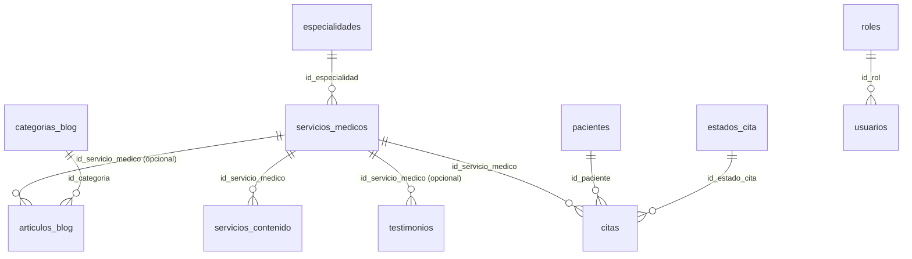

# Base de datos – PostgreSQL

Base `surgeon` de la API (Entity Framework Core 9 + Npgsql). **Este documento se generó a partir de la estructura real de la base.**

## Resumen

- **18 tablas** de la aplicación + `__EFMigrationsHistory` (control de migraciones de Entity Framework).
- **9 relaciones** (claves foráneas).
- **Procedimientos almacenados, funciones, vistas y triggers: ninguno.** Toda la lógica está en la API (C#), que consulta con LINQ / Entity Framework.
- **Migraciones aplicadas:** `20261121202337_Inicial`.
- Nombres en `snake_case` (convención de PostgreSQL). En C# las propiedades siguen en PascalCase; la conversión es automática.
- Todas las tablas tienen `id` (entero autoincremental, clave primaria) y 4 columnas de auditoría: `usuario_modificacion`, `fecha_modificacion`, `ip_modificacion` y `eliminado`. **`eliminado = true` es un borrado lógico**: la fila sigue en la tabla pero la API la ignora.
- Los textos se guardan como `text` (sin límite en la base); los límites de largo se validan en la API.

## Diagrama de relaciones

## Relaciones

| Tabla | Columna | Apunta a | Obligatoria | Al borrar el padre |
|---|---|---|---|---|
| `articulos_blog` | `id_categoria` | `categorias_blog.id` | Sí | Impedido (RESTRICT) |
| `articulos_blog` | `id_servicio_medico` | `servicios_medicos.id` | No | Impedido (RESTRICT) |
| `citas` | `id_estado_cita` | `estados_cita.id` | Sí | Impedido (RESTRICT) |
| `citas` | `id_paciente` | `pacientes.id` | Sí | Impedido (RESTRICT) |
| `citas` | `id_servicio_medico` | `servicios_medicos.id` | Sí | Impedido (RESTRICT) |
| `servicios_contenido` | `id_servicio_medico` | `servicios_medicos.id` | Sí | Impedido (RESTRICT) |
| `servicios_medicos` | `id_especialidad` | `especialidades.id` | Sí | Impedido (RESTRICT) |
| `testimonios` | `id_servicio_medico` | `servicios_medicos.id` | No | Impedido (RESTRICT) |
| `usuarios` | `id_rol` | `roles.id` | Sí | Impedido (RESTRICT) |

## Índices únicos

| Tabla | Columna(s) única(s) |
|---|---|
| `articulos_blog` | `slug` |
| `categorias_blog` | `slug` |
| `paginas_legales` | `clave` |
| `paginas_seo` | `clave` |
| `redirecciones` | `ruta_origen` |
| `roles` | `nombre` |
| `servicios_medicos` | `slug` |
| `usuarios` | `correo` |

## Tablas

### Consultorio y agenda

#### `pacientes` — 1 filas

Personas que solicitan cita desde la web.

| Columna | Tipo | Nulo | Notas |
|---|---|---|---|
| `id` | int | no | Clave primaria, autoincremental |
| `nombres` | text | no |  |
| `apellidos` | text | no |  |
| `numero_documento` | text | sí |  |
| `correo` | text | no |  |
| `telefono` | text | no |  |
| `fecha_nacimiento` | timestamp | sí |  |
| `antecedentes_relevantes` | text | sí |  |

+ columnas de auditoría

#### `citas` — 1 filas

Solicitudes de cita: fecha, procedimiento, motivo y estado.

| Columna | Tipo | Nulo | Notas |
|---|---|---|---|
| `id` | int | no | Clave primaria, autoincremental |
| `id_paciente` | int | no | → `pacientes.id` |
| `id_servicio_medico` | int | no | → `servicios_medicos.id` |
| `fecha_hora_inicio` | timestamp | no |  |
| `fecha_hora_fin` | timestamp | no |  |
| `id_estado_cita` | int | no | → `estados_cita.id` |
| `motivo_consulta` | text | sí |  |
| `notas_medico` | text | sí |  |
| `precio_consulta` | numeric(10,2) | sí |  |

+ columnas de auditoría

#### `estados_cita` — 4 filas

Catálogo: Pendiente, Confirmada, Atendida, Cancelada (con color para el CMS).

| Columna | Tipo | Nulo | Notas |
|---|---|---|---|
| `id` | int | no | Clave primaria, autoincremental |
| `nombre` | text | no |  |
| `color_hex` | text | no |  |

+ columnas de auditoría

#### `horarios_atencion` — 11 filas

Turnos de atención por día de la semana (1 = lunes … 7 = domingo).

| Columna | Tipo | Nulo | Notas |
|---|---|---|---|
| `id` | int | no | Clave primaria, autoincremental |
| `dia_semana` | int | no |  |
| `hora_inicio` | time | no |  |
| `hora_fin` | time | no |  |
| `es_activo` | bool | no |  |

+ columnas de auditoría

#### `bloqueos_horario` — 0 filas

Días u horas bloqueados (vacaciones, congresos). Aún sin pantalla en el CMS.

| Columna | Tipo | Nulo | Notas |
|---|---|---|---|
| `id` | int | no | Clave primaria, autoincremental |
| `fecha_inicio` | timestamp | no |  |
| `fecha_fin` | timestamp | no |  |
| `motivo` | text | no |  |

+ columnas de auditoría

#### `mensajes_contacto` — 0 filas

Mensajes de un formulario de contacto. Aún sin uso.

| Columna | Tipo | Nulo | Notas |
|---|---|---|---|
| `id` | int | no | Clave primaria, autoincremental |
| `nombre` | text | no |  |
| `correo` | text | no |  |
| `telefono` | text | sí |  |
| `asunto` | text | sí |  |
| `mensaje` | text | no |  |
| `leido` | bool | no |  |
| `fecha_envio` | timestamp | no |  |

+ columnas de auditoría

### Contenido de la web

#### `especialidades` — 4 filas

Agrupan los procedimientos (Cirugía Laparoscópica, Pared Abdominal…).

| Columna | Tipo | Nulo | Notas |
|---|---|---|---|
| `id` | int | no | Clave primaria, autoincremental |
| `nombre` | text | no |  |
| `descripcion` | text | sí |  |
| `icono` | text | sí |  |

+ columnas de auditoría

#### `servicios_medicos` — 5 filas

Procedimientos: cada uno tiene su página /procedimientos/{slug} y su SEO.

| Columna | Tipo | Nulo | Notas |
|---|---|---|---|
| `id` | int | no | Clave primaria, autoincremental |
| `nombre` | text | no |  |
| `nombre_corto` | text | sí |  |
| `slug` | text | no |  |
| `resumen` | text | no |  |
| `descripcion_detallada` | text | sí |  |
| `tiempo_estimado_minutos` | int | no |  |
| `precio_referencial` | numeric(10,2) | sí |  |
| `icono` | text | sí |  |
| `id_especialidad` | int | no | → `especialidades.id` |
| `destacado_en_web` | bool | no |  |
| `orden` | int | no |  |
| `condicion_tratada` | text | sí |  |
| `titulo_indicaciones` | text | sí |  |
| `meta_titulo` | text | sí |  |
| `meta_descripcion` | text | sí |  |
| `imagen_og_url` | text | sí |  |
| `indexable` | bool | no |  |

+ columnas de auditoría

#### `servicios_contenido` — 89 filas

Bloques de la página de un procedimiento. tipo: Introduccion, Indicacion, Paso, Recuperacion o Pregunta.

| Columna | Tipo | Nulo | Notas |
|---|---|---|---|
| `id` | int | no | Clave primaria, autoincremental |
| `id_servicio_medico` | int | no | → `servicios_medicos.id` |
| `tipo` | text | no |  |
| `titulo` | text | sí |  |
| `texto` | text | no |  |
| `orden` | int | no |  |

+ columnas de auditoría

#### `categorias_blog` — 7 filas

Categorías del blog.

| Columna | Tipo | Nulo | Notas |
|---|---|---|---|
| `id` | int | no | Clave primaria, autoincremental |
| `nombre` | text | no |  |
| `slug` | text | no |  |

+ columnas de auditoría

#### `articulos_blog` — 3 filas

Artículos del blog (/blog/{slug}) con su SEO; pueden enlazar a un procedimiento.

| Columna | Tipo | Nulo | Notas |
|---|---|---|---|
| `id` | int | no | Clave primaria, autoincremental |
| `titulo` | text | no |  |
| `slug` | text | no |  |
| `resumen` | text | no |  |
| `contenido_html` | text | no |  |
| `imagen_portada_url` | text | sí |  |
| `id_categoria` | int | no | → `categorias_blog.id` |
| `id_servicio_medico` | int | sí | → `servicios_medicos.id` |
| `autor` | text | no |  |
| `tiempo_lectura_minutos` | int | no |  |
| `fecha_publicacion` | timestamp | no |  |
| `publicado_en_web` | bool | no |  |
| `vistas` | int | no |  |
| `destacado` | bool | no | Se muestra en grande en /blog; solo uno a la vez |
| `meta_titulo` | text | sí |  |
| `meta_descripcion` | text | sí |  |
| `imagen_og_url` | text | sí |  |
| `indexable` | bool | no |  |

+ columnas de auditoría

#### `testimonios` — 3 filas

Testimonios de pacientes; se publican solo si aprobado_para_web = true. Los que envía un paciente desde la web entran con pendiente_revision = true y aprobado_para_web = false hasta que el administrador los revisa en el CMS.

| Columna | Tipo | Nulo | Notas |
|---|---|---|---|
| `id` | int | no | Clave primaria, autoincremental |
| `nombre_paciente` | text | no |  |
| `procedimiento` | text | no |  |
| `id_servicio_medico` | int | sí | → `servicios_medicos.id` |
| `calificacion_estrellas` | int | no |  |
| `comentario` | text | no |  |
| `fecha_testimonio` | timestamp | no |  |
| `aprobado_para_web` | bool | no |  |
| `enviado_desde_web` | bool | no | Lo envió un paciente (no el administrador) |
| `pendiente_revision` | bool | no | Esperando revisión en el CMS |
| `autoriza_publicacion` | bool | no | El paciente autorizó publicarlo con su nombre (Ley 29733) |
| `contacto_paciente` | text | sí | Teléfono o correo para verificarlo; nunca se publica |

+ columnas de auditoría

#### `paginas_legales` — 3 filas

Privacidad, términos y consentimiento informado (rutas fijas, contenido editable).

| Columna | Tipo | Nulo | Notas |
|---|---|---|---|
| `id` | int | no | Clave primaria, autoincremental |
| `clave` | text | no |  |
| `ruta` | text | no |  |
| `titulo` | text | no |  |
| `contenido_html` | text | no |  |
| `publicada` | bool | no |  |
| `meta_titulo` | text | sí |  |
| `meta_descripcion` | text | sí |  |
| `imagen_og_url` | text | sí |  |
| `indexable` | bool | no |  |

+ columnas de auditoría

### SEO y configuración

#### `configuracion_sitio` — 1 filas

Una sola fila: datos del doctor, contacto, pie de página, redes y Google.

| Columna | Tipo | Nulo | Notas |
|---|---|---|---|
| `id` | int | no | Clave primaria, autoincremental |
| `nombre_doctor` | text | no |  |
| `nombre_corto` | text | sí |  |
| `especialidad` | text | sí |  |
| `cmp` | text | sí |  |
| `rne` | text | sí |  |
| `foto_doctor_url` | text | sí |  |
| `seguros_aliados` | text | sí |  |
| `telefono_principal` | text | sí |  |
| `telefono_secundario` | text | sí |  |
| `whats_app` | text | sí |  |
| `correo` | text | sí |  |
| `direccion` | text | sí |  |
| `distrito` | text | sí |  |
| `ciudad` | text | sí |  |
| `region` | text | sí |  |
| `pais` | text | no |  |
| `google_maps_url` | text | sí |  |
| `descripcion_pie` | text | sí |  |
| `mostrar_emergencias` | bool | no |  |
| `texto_emergencias` | text | sí |  |
| `reserva_clinica_activa` | bool | no | «Agendar cita» ofrece también reservar en una clínica (ej.: SANNA) |
| `reserva_clinica_nombre` | text | sí | Ej.: «Clínica SANNA San Borja» |
| `reserva_clinica_url` | text | sí | Página de la clínica; puede llevar `#:~:text=` para resaltar el nombre |
| `reserva_clinica_telefono` | text | sí | Central telefónica de la clínica |
| `reserva_clinica_texto_busqueda` | text | sí | Nombre que el paciente busca en la web de la clínica |
| `facebook_url` | text | sí |  |
| `instagram_url` | text | sí |  |
| `tik_tok_url` | text | sí |  |
| `you_tube_url` | text | sí |  |
| `linked_in_url` | text | sí |  |
| `site_url` | text | no |  |
| `meta_titulo_por_defecto` | text | sí |  |
| `meta_descripcion_por_defecto` | text | sí |  |
| `imagen_og_por_defecto_url` | text | sí |  |
| `google_site_verification` | text | sí |  |
| `google_analytics_id` | text | sí |  |

+ columnas de auditoría

#### `paginas_seo` — 5 filas

SEO y textos visibles de las páginas fijas: inicio, procedimientos, blog, perfil-doctor, contacto.

| Columna | Tipo | Nulo | Notas |
|---|---|---|---|
| `id` | int | no | Clave primaria, autoincremental |
| `clave` | text | no |  |
| `ruta` | text | no |  |
| `nombre_pagina` | text | no |  |
| `titulo` | text | sí | Título visible (h1); vacío = texto por defecto de la web |
| `descripcion` | text | sí | Frase bajo el título |
| `titulo_secundario` | text | sí | Título de una sección secundaria (columna lateral del blog) |
| `meta_titulo` | text | sí |  |
| `meta_descripcion` | text | sí |  |
| `imagen_og_url` | text | sí |  |
| `indexable` | bool | no |  |

+ columnas de auditoría

#### `redirecciones` — 0 filas

Redirecciones 301 de URLs antiguas a nuevas (se crean solas al cambiar un slug).

| Columna | Tipo | Nulo | Notas |
|---|---|---|---|
| `id` | int | no | Clave primaria, autoincremental |
| `ruta_origen` | text | no |  |
| `ruta_destino` | text | no |  |
| `es_permanente` | bool | no |  |
| `activa` | bool | no |  |
| `nota` | text | sí |  |

+ columnas de auditoría

### Acceso al CMS

#### `roles` — 4 filas

Administrador, Cirujano, Secretaria, Paciente.

| Columna | Tipo | Nulo | Notas |
|---|---|---|---|
| `id` | int | no | Clave primaria, autoincremental |
| `nombre` | text | no |  |

+ columnas de auditoría

#### `usuarios` — 1 filas

Usuarios del CMS. La contraseña se guarda cifrada con BCrypt (nunca en texto plano).

| Columna | Tipo | Nulo | Notas |
|---|---|---|---|
| `id` | int | no | Clave primaria, autoincremental |
| `nombre_completo` | text | no |  |
| `correo` | text | no |  |
| `password_hash` | text | no |  |
| `telefono` | text | sí |  |
| `id_rol` | int | no | → `roles.id` |
| `es_activo` | bool | no |  |

+ columnas de auditoría

## Archivos relacionados

| Archivo | Qué es |
|---|---|
| `Surgeon.Domain/Entities/*.cs` | Entidades (una por tabla) |
| `Surgeon.Infrastructure/Persistence/SurgeonDbContext.cs` | Relaciones, índices y tipos especiales |
| `Surgeon.Infrastructure/Persistence/Migraciones/` | Migraciones de EF Core (crean y actualizan las tablas) |
| `Surgeon.Infrastructure/Persistence/Datos/datos_iniciales.sql` | Contenido inicial para una base nueva |
